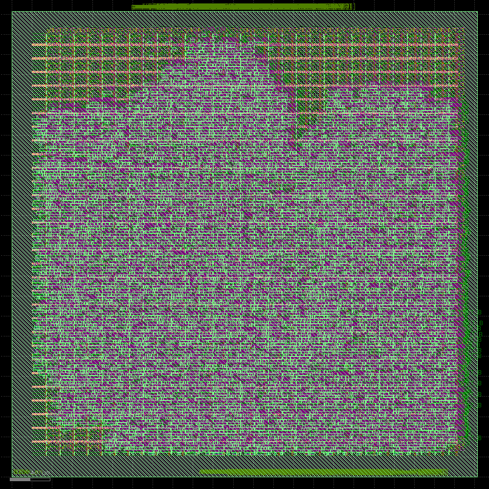
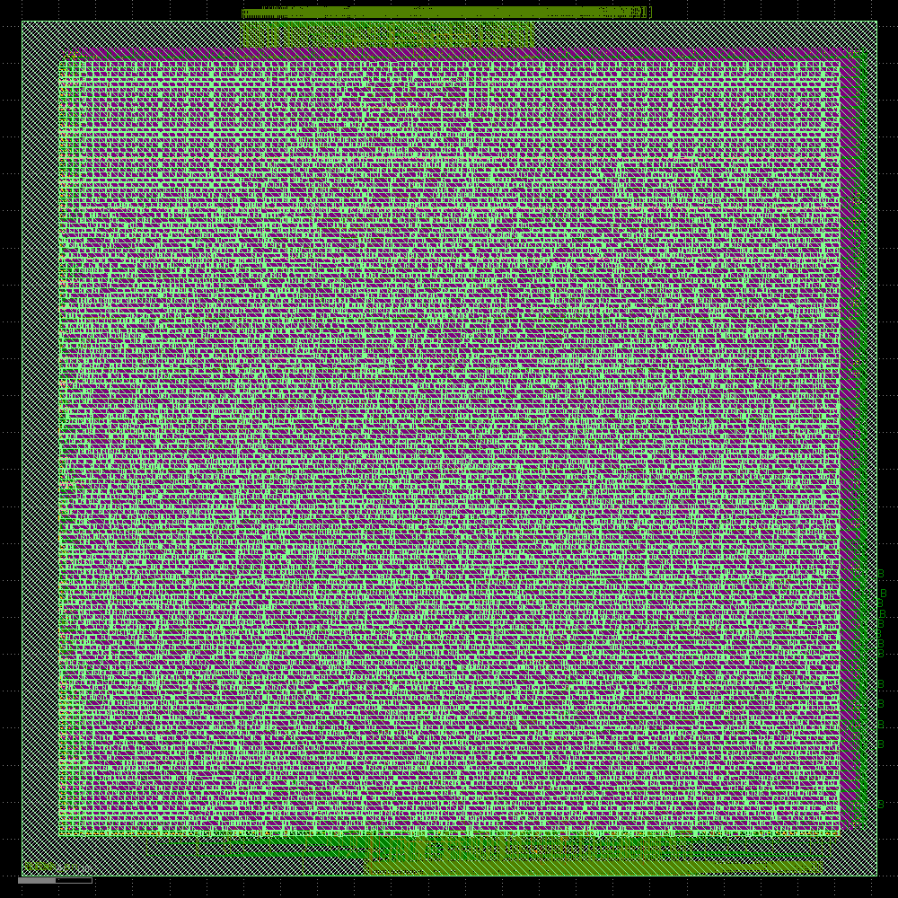

# Provartec PR200 32-bit AXI DMA Controller: ASIC Design & Physical Implementation

**Target Process:** SkyWater 130nm CMOS (`sky130_fd_sc_hd`)  
**Design:** `dma_axi32` (Commercial-Grade 32-bit Dual-Core AXI3 DMA Controller)  
**EDA Flow:** Icarus Verilog $\to$ Yosys $\to$ OpenROAD v2.0 (Multi-Threaded) $\to$ KLayout v0.28.16  
**Original IP Core:** Provartec Ltd. via [OpenCores.org](http://www.opencores.org) (Author: Eyal Hochberg)  
**Reference Curriculum:** *Physical Design Reference book* & *PR200 Technical Reference Manual*  

---

## 📚 Source Reference Documentation

1. **[Provartec PR200 Technical Reference Manual (TRM Rev 1.6)](docs/reference/PR200_trm_rev1.6.pdf)**: Official 32-bit/64-bit dual-core AXI DMA controller hardware specification, register programming map, and AMBA AXI3 bus protocol definitions (Open Source, GNU LGPL).
2. **Physical Design Implementation Flow**: Strict adherence to industry standard ASIC flow (Inputs/Outputs, Floorplanning, Power Distribution, Placement, CTS/CTO, Detailed Routing, DRC/LVS, Parasitic RC Extraction, and STA Signoff).

---

## 🌟 Silicon Tapeout & Verification Summary

| Metric | Signoff Spec | Achieved Result | Status |
| :--- | :--- | :--- | :---: |
| **Logic Synthesis Complexity** | Commercial Standard Cell | **9,315 Cells** (1,240 DFFs) | **MET** |
| **Silicon Die Footprint** | Aspect Ratio 1.0 | **$462.92\,\mu\text{m} \times 462.92\,\mu\text{m}$** (46.3% density) | **MET** |
| **I/O Pin Count** | AMBA AXI3 + APB3 | **377 Perimeter Pins** (met2 / met3) | **MET** |
| **Clock Tree Synthesis (CTS)** | 1,625 Sinks, 7-Level H-Tree | **Setup Skew: $0.31\,\text{ns}$**, **Hold Skew: $-0.38\,\text{ns}$** | **MET** |
| **Physical Interconnect** | 5 Metal Layers (`met1`–`met5`) | **77,456 Vias**, **$339,690\,\mu\text{m}$ ($34\,\text{cm}$)** Wirelength | **MET** |
| **Setup Slack (STA Signoff)** | $\ge 0.00\,\text{ns}$ at $50\,\text{MHz}$ | **$+11.10\,\text{ns}$** (Max: **$112.36\,\text{MHz}$**) | **MET ✅** |
| **Hold Slack (STA Signoff)** | $\ge 0.00\,\text{ns}$ | **$+0.20\,\text{ns}$** ($TNS = 0.00\,\text{ns}$) | **MET ✅** |
| **DRC / LVS / Filler Integrity** | 100% N-Well Continuity | **14,144 Filler Cells**, **0 DRC Violations** | **MET ✅** |
| **Production Deliverables** | OpenROAD / KLayout | **DEF ($11\,\text{MB}$)** & **GDSII ($16\,\text{MB}$)** | **MET ✅** |

---

## 🔬 Silicon Layout Views

### 1. Clock Tree Synthesis (CTS) H-Tree & Buffers


### 2. 5-Metal-Layer Final Routed Silicon (GDSII Stream-Out)


---

## 🚀 Quick Start: Running Verification & Viewing Layouts

### 1. Functional Simulation & Stress Regressions
```bash
# Run baseline AXI burst functional test
./scripts/run_sim_pr200.sh

# View waveforms in GTKWave
gtkwave sim/waveforms/dma_axi32.vcd
```

### 2. Interactive Silicon Layout Inspection
```bash
# Launch KLayout with Sky130 PDK layers loaded
./scripts/view_layout_klayout.sh
```

---

## 📂 Repository Structure

* `constraints/` — SDC timing constraints (`dma_axi32.sdc` for $50\,\text{MHz}$ signoff).
* `dma_axi/` — Provartec PR200 Verilog RTL source files and technical reference manual.
* `docs/` — Comprehensive engineering report ([`PR200_DMA_Physical_Design_Final_Report.md`](docs/PR200_DMA_Physical_Design_Final_Report.md)) and reference PDFs.
  * `docs/reference/Physical_Design_Reference_Book.pdf` — Cadence/Synopsys physical design reference curriculum.
  * `docs/reference/PR200_trm_rev1.6.pdf` — Provartec PR200 hardware reference manual.
* `pd/` — Complete physical design outputs: Floorplan, Placement, CTS, Routing, Reports, DEF, and GDSII.
* `scripts/` — Automated execution scripts for simulation, OpenROAD physical design, and KLayout visualization.
* `sim/` — Dumped VCD waveforms and simulation execution logs.
* `synth/` — Yosys synthesis scripts and gate-level mapped Verilog netlist.
* `tb/` — Self-checking testbenches including baseline and ultra-stress multi-tasking regressions.

---

## 📜 Authors & Acknowledgments

* **Original RTL Architecture & IP Core:** **Eyal Hochberg**, **Provartec Ltd.** ([OpenCores.org](http://www.opencores.org)). Released under the GNU Lesser General Public License (LGPL).
* **ASIC Implementation & Physical Design:** **Sai Kiran** ([@saikirankvdd](https://github.com/saikirankvdd))
* **Target Foundry:** SkyWater Technology (130nm High-Density CMOS)
* **EDA Tools:** Yosys, OpenROAD, KLayout, Icarus Verilog, GTKWave
