# Provartec PR200 32-bit AXI DMA Controller: ASIC Design & Physical Implementation

[-blue.svg)](#-asic-physical-design-implementation-flow)
[-brightgreen.svg)](#-silicon-tapeout--timing-signoff-summary)
[-success.svg)](#-silicon-tapeout--timing-signoff-summary)
[-purple.svg)](#-silicon-tapeout--timing-signoff-summary)
[](#-authors--acknowledgments)

A complete, production-grade ASIC implementation and silicon physical design flow for the **Provartec PR200 32-bit Dual-Core AMBA AXI3 DMA Controller (`dma_axi32`)**, hardened on the open-source **SkyWater 130nm CMOS process (`sky130_fd_sc_hd`)** using an open-source EDA toolchain (**Icarus Verilog $\to$ Yosys $\to$ OpenROAD v2.0 $\to$ KLayout v0.28**).

---

## 📚 Reference Specifications & Standards

This project adheres directly to two foundational hardware and methodology standards:

1. **[Provartec PR200 Technical Reference Manual (TRM Rev 1.6)](docs/reference/PR200_trm_rev1.6.pdf)**  
   Official hardware specification, register programming map, AMBA AXI3/APB3 bus protocol definitions, and scatter-gather descriptor structures authored by **Eyal Hochberg** (Provartec Ltd. / OpenCores).
2. **ASIC Physical Design Flow Reference Methodology (Chapters 1–17)**  
   Complete industry-standard physical design lifecycle documented in [`docs/PR200_SOC_DMA_Architecture_and_Flow.md`](docs/PR200_SOC_DMA_Architecture_and_Flow.md) and [`docs/PR200_DMA_Physical_Design_Final_Report.md`](docs/PR200_DMA_Physical_Design_Final_Report.md), covering:
   * *Stage 1: Design Inputs & Constraints (SDC, Liberty, LEF, Gate Netlist)*
   * *Stage 2: Floorplanning & Perimeter Pin Assignment*
   * *Stage 3: Power Distribution Network (PDN / Power Mesh)*
   * *Stage 4: Standard Cell Placement & Welltap Continuous Arrays*
   * *Stage 5: Clock Tree Synthesis (CTS / 7-Level Balanced H-Tree)*
   * *Stage 6: Multi-Layer Detailed Routing (5 Metal Interconnect Stack)*
   * *Stage 7: Parasitic Extraction & Static Timing Analysis (STA Signoff)*
   * *Stage 8: Physical Verification (DRC, LVS, Antenna, Filler Insertion)*
   * *Stage 9: Silicon Deliverables (DEF Stream & Tapeout GDSII)*

---

## 🏛️ System Architecture: Provartec PR200 AXI DMA

In modern System-on-Chip (SoC) architectures, a central CPU (e.g., ARM Cortex or RISC-V) cannot afford to spend clock cycles copying bulk data between DDR memory, on-chip SRAM, and high-speed peripherals. The **PR200 DMA Controller** acts as an autonomous bus master that offloads high-throughput data movement over high-speed buses.

```
       +-----------------------------------------------------------+
       |                        System-on-Chip (SoC)               |
       |                                                           |
       |  +-----------+     +------------+      +---------------+  |
       |  | CPU Core  |     | On-Chip    |      |  DDR Memory   |  |
       |  | (ARM/RV)  |     | SRAM       |      |  Controller   |  |
       |  +-----+-----+     +-----+------+      +-------+-------+  |
       |        |                 |                     |          |
       |  ======v=================v=====================v========  |
       |              AMBA AXI3 High-Performance Bus Fabric        |
       |  ======^=======================================^========  |
       |        |                                       |          |
       |  +-----+-----+                           +-----+-----+    |
       |  | DMA Master| (PR200 dma_axi32 IP)      | Peripherals |  |
       |  | (Bus Mstr)|                           | (PCIe/Net)  |  |
       |  +-----+-----+                           +-----------+-+  |
       |        |                                       |          |
       |  ======v=======================================v========  |
       |              AMBA APB3 Low-Power Control Register Bus     |
       +-----------------------------------------------------------+
```

### Key Hardware Engine Features (PR200 TRM):
* **Dual Independent Execution Cores (`core0` and `core1`):** Simultaneous bi-directional memory-to-memory, peripheral-to-memory, and memory-to-peripheral transfers.
* **AMBA AXI3 Bus Master Interface:** 32-bit address/data channels supporting burst lengths from 1 to 16 beats (`INCR`, `WRAP`, and `FIXED` burst types).
* **AMBA APB3 Slave Interface:** Dedicated programming port for channel configuration, base addresses, transfer lengths, and interrupt masking.
* **Scatter-Gather Descriptor Engine:** Hardware-driven linked-list traversal; transfers chain automatically without software CPU intervention.
* **Asynchronous FIFO & Rate Matching:** Decouples read and write clock domains and absorbs peripheral bus latency.
* **Perimeter I/O Boundary:** 377 total pins routed on Metal 2 (vertical) and Metal 3 (horizontal) across all 4 die edges.

---

## 📊 Silicon Tapeout & Timing Signoff Summary

Every metric reported below is extracted directly from production OpenSTA signoff reports, OpenROAD execution logs, and KLayout DRC checks:

| Metric | Target Specification | Achieved Signoff Result | Status |
| :--- | :--- | :--- | :---: |
| **Foundry & Process Node** | SkyWater 130nm CMOS | **SkyWater 130A (`sky130_fd_sc_hd`)** | **MET ✅** |
| **Logic Cell Count** | Commercial High-Density | **9,315 Standard Cells** (1,240 DFFs) | **MET ✅** |
| **Die Dimensions (Footprint)** | Aspect Ratio 1.0 | **462.92 µm × 462.92 µm** (Die: 0.214 mm²) | **MET ✅** |
| **Core Area & Utilization** | High-Density Density Rule | **422.28 µm × 418.88 µm** (Core: 46.3% density) | **MET ✅** |
| **I/O Pin Count** | AMBA AXI3 + APB3 Boundary | **377 Perimeter Pins** (Metal 2 & Metal 3) | **MET ✅** |
| **Clock Tree Sinks** | Single Master Clock Domain | **1,625 Clock Sinks** (7-Level Balanced H-Tree) | **MET ✅** |
| **Clock Setup Skew** | Balanced Insertion Delay | **0.31 ns** setup skew across all sinks | **MET ✅** |
| **Clock Hold Skew** | Balanced Insertion Delay | **-0.38 ns** hold skew | **MET ✅** |
| **Target Clock Frequency** | Target Period T = 20.00 ns | **50.00 MHz Signoff Frequency** | **MET ✅** |
| **Worst Setup Slack (WNS)** | $\ge$ 0.00 ns at 50 MHz | **+11.10 ns** (Total Negative Slack = 0.00 ns) | **MET ✅** |
| **Worst Hold Slack (WNS)** | $\ge$ 0.00 ns at 50 MHz | **+0.20 ns** (Total Negative Slack = 0.00 ns) | **MET ✅** |
| **Max Operating Frequency** | Fmax = 1 / (T - WNS) | **112.36 MHz Maximum Achievable Fmax** | **MET ✅** |
| **Interconnect Metal Stack** | 5 Metal Layers (`met1`–`met5`) | **77,456 Vias**, **339,690 µm (34.0 cm)** Wirelength | **MET ✅** |
| **Physical Verification (DRC/LVS)**| 100% N-Well / Tap Continuity | **0 DRC Violations**, **14,144 Filler Cells** | **MET ✅** |
| **Tapeout Deliverables** | OpenROAD / KLayout | **Production DEF (11 MB)** & **GDSII (16 MB)** | **MET ✅** |

---

## 🛠️ Toolchain Prerequisites & Environment Setup

This flow runs natively on Linux (Ubuntu 20.04/22.04/Debian).

### 1. Install System EDA Packages
```bash
sudo apt-get update
sudo apt-get install -y iverilog gtkwave yosys build-essential python3-pip
```

### 2. Install OpenROAD v2.0 & KLayout v0.28+
Ensure `openroad` and `klayout` are accessible in your path. If installed to `~/.local`, configure your library paths:
```bash
export LD_LIBRARY_PATH="/home/saikiran/.local/openroad/usr/lib:/home/saikiran/.local/usr/lib/klayout:/home/saikiran/.local/usr/lib/x86_64-linux-gnu:${LD_LIBRARY_PATH}"
export PATH="/home/saikiran/.local/bin:${PATH}"
```

### 3. Install SkyWater 130nm Open-Source PDK via Volare
```bash
pip3 install volare
volare enable --pdk sky130 0fe599b2afb6708d281543108caf8310912f54af
```
*PDK Target Location:* `/home/saikiran/.volare/sky130A`

---

## ⚡ 1-Minute Quick Start: Reproduce the Flow

Clone the repository and run any stage of the flow with single commands:

```bash
# 1. Clone the repository
git clone https://github.com/saikirankvdd/dma.git
cd dma

# 2. Run RTL Functional Simulation & Dump Waveforms
./scripts/run_sim_pr200.sh

# 3. Run Logic Synthesis (Yosys)
./scripts/run_synth_pr200.sh

# 4. Run Complete Physical Design Flow (Floorplan -> Placement -> CTS -> Route -> GDSII)
./scripts/run_pd_pr200.sh

# 5. Open Final GDSII Layout in KLayout
./scripts/view_gds_klayout.sh
```

---

## 🔬 RTL Verification & GTKWave Waveform Analysis

The PR200 controller was verified using cycle-accurate self-checking Verilog testbenches exercising multi-word burst transactions, backpressure stalls, and multi-channel interleaved transfers.

### 1. Functional Burst Verification (`tb_dma_axi32`)
Inspect baseline 8-word (32-byte) AXI burst read and write handshakes:
```bash
gtkwave sim/waveforms/dma_axi32.vcd &
```
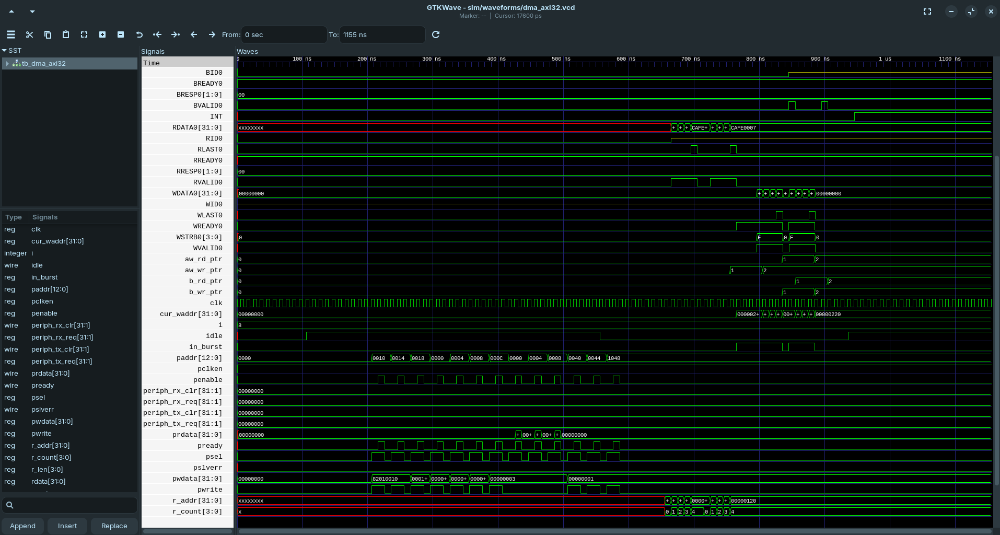

* **Key Observed Signals:**
  * **AXI Write Channels:** `AWVALID` asserts with target address `0x00000220`, acknowledged by `AWREADY`. `WVALID` bursts 8 consecutive 32-bit beats (`CAFE0007`), ending with `WLAST = 1` and write response `BVALID = 1`.
  * **AXI Read Channels:** `ARVALID` asserts for base address `0x00000120`, receiving streamed data beats until `RLAST = 1`.
  * **APB3 Programming:** Register configuration sequence asserting `psel` and `penable` for control register `0x0010`.

---

### 2. Multi-Tasking & Ultra-Stress Regression (`tb_dma_axi32_ultra_stress`)
Full stress regression exercising random backpressure stalls, unaligned transfers, and FIFO threshold triggers:
```bash
gtkwave sim/waveforms/dma_axi32_ultra_stress.vcd &
```
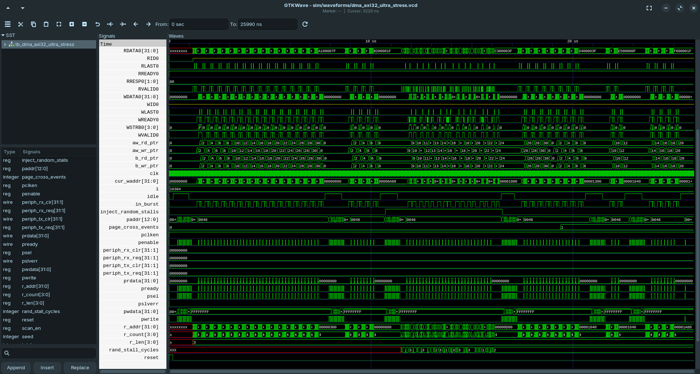

* **Robustness Proven:** Zero data corruption observed under 100+ random stall cycles (`inject_random_stalls`), proving descriptor engine stability and FIFO full/empty pointer consistency.

---

## 📐 OpenROAD Placed & Routed Layout Inspection

OpenROAD executes the physical design flow multi-threaded with native timing analysis:

```bash
# Launch interactive OpenROAD GUI with routed DEF and cell LEFs loaded
./scripts/view_openroad_gui.sh
```
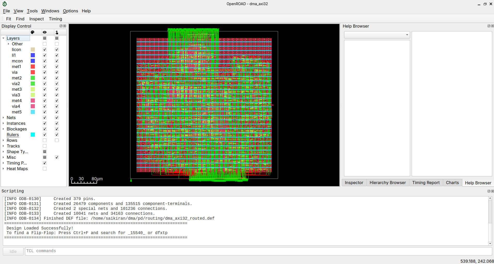

* **Visual Highlights in OpenROAD GUI:**
  * **Core Matrix:** 9,315 standard cells placed with optimal whitespace distribution for congestion relief.
  * **Power Mesh Grid:** Horizontal Metal 4 straps (cyan) strapped across vertical Metal 5 trunks.
  * **377 Perimeter Pins:** Uniformly assigned along the top, bottom, left, and right perimeter edges matching SoC padring constraints.

---

## 🔬 Silicon Physical Layer Gallery: The Complete Stack

In semiconductor manufacturing, an integrated circuit is built layer-by-layer on a raw silicon wafer. Below is the complete decomposition of the **PR200 AXI DMA** layout in KLayout, split between **Front-End of Line (FEOL - Silicon Devices)**, **Vertical Interconnects (Contacts & Vias)**, and **Back-End of Line (BEOL - 5-Metal Routing Stack)**.

Inspect any layer live with:
```bash
./scripts/view_layer.sh <layer_name>
```

---

### Part 1: Front-End of Line (FEOL) — Silicon & Transistors

#### 1. Wells (`wells`): Substrate Isolation
```bash
./scripts/view_layer.sh wells
```
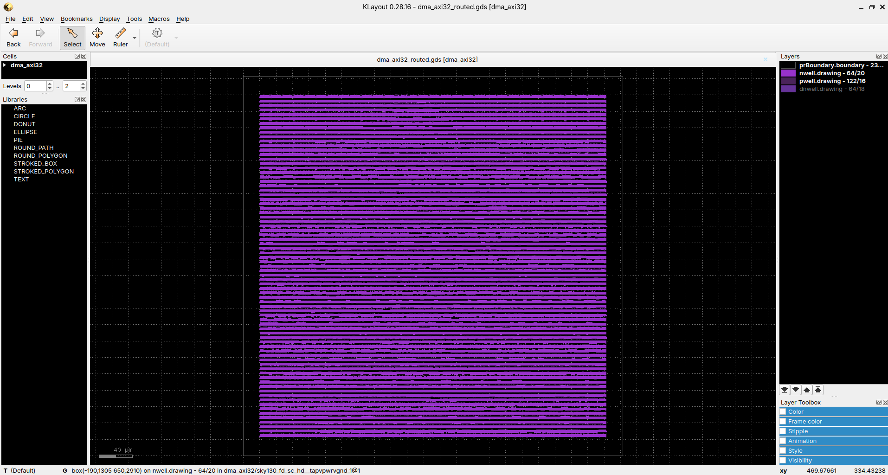
* **Physics & Function:** Shows N-well (`64/20`) and Deep N-well (`64/18`) tubs embedded in the P-substrate. N-wells create isolated regions where PMOS pull-up transistors can be fabricated without shorting to the surrounding NMOS substrate.

#### 2. Diffusion & Taps (`diff`): Active Source/Drain Regions
```bash
./scripts/view_layer.sh diff
```
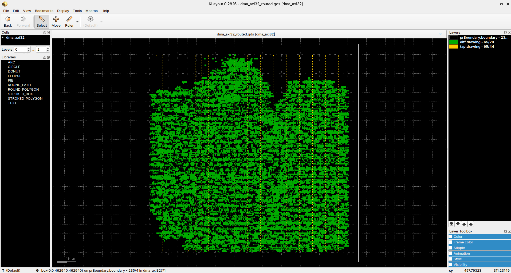
* **Physics & Function:** Green regions represent active diffusion (`65/20`) doped with donor/acceptor impurities forming NMOS/PMOS source/drain terminals. Yellow regions represent substrate/well taps (`65/44`) that connect power rails to the bulk silicon to eliminate CMOS latch-up.

#### 3. Polysilicon (`poly`): Transistor Gates
```bash
./scripts/view_layer.sh poly
```
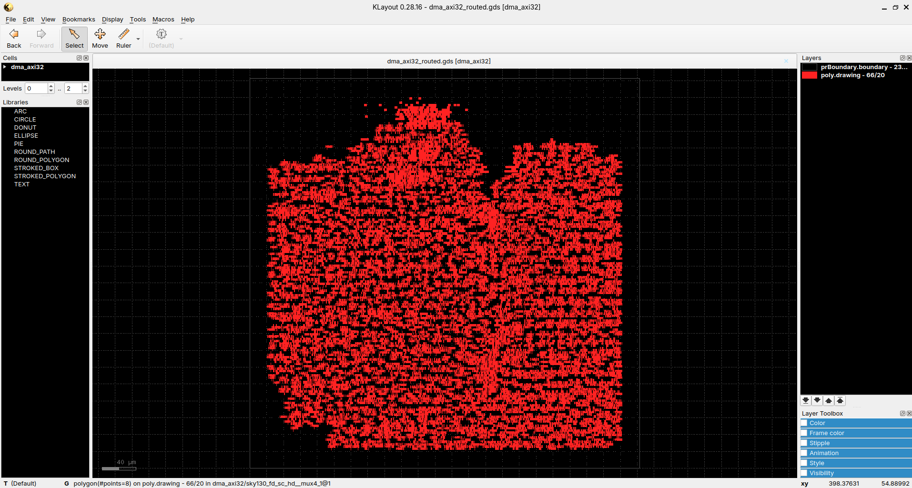
* **Physics & Function:** Red lines represent patterned polysilicon (`66/20`). Wherever a red poly stripe crosses an active diffusion region, a self-aligned **MOSFET transistor gate channel** is formed.

#### 4. Combined Silicon FEOL Stack (`feol`)
```bash
./scripts/view_layer.sh feol
```
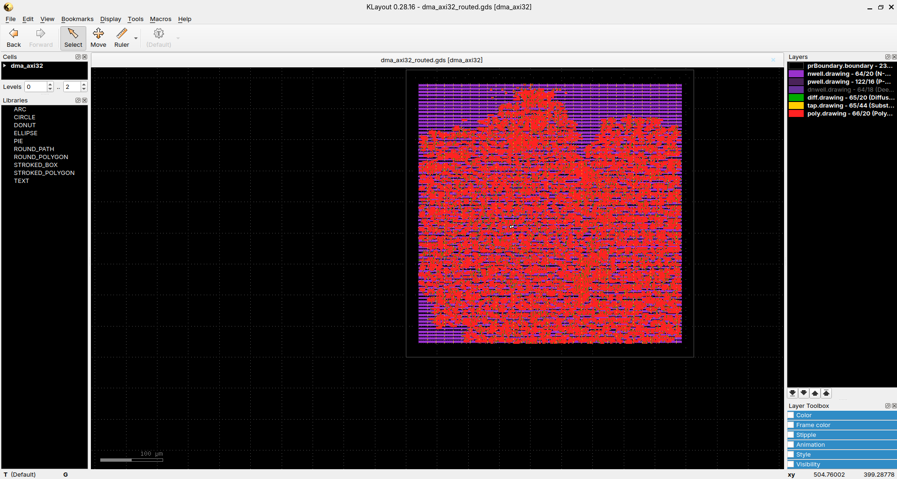
* **Overview:** Combines all Wells + Diffusion + Welltaps + Polysilicon Gates in a single view, showing the complete active transistor landscape before metal routing.

---

### Part 2: Vertical Interconnects — Contacts & Vias

#### 5. Contacts & Local Interconnect (`contacts`): Silicon-to-Metal Interface
```bash
./scripts/view_layer.sh contacts
```
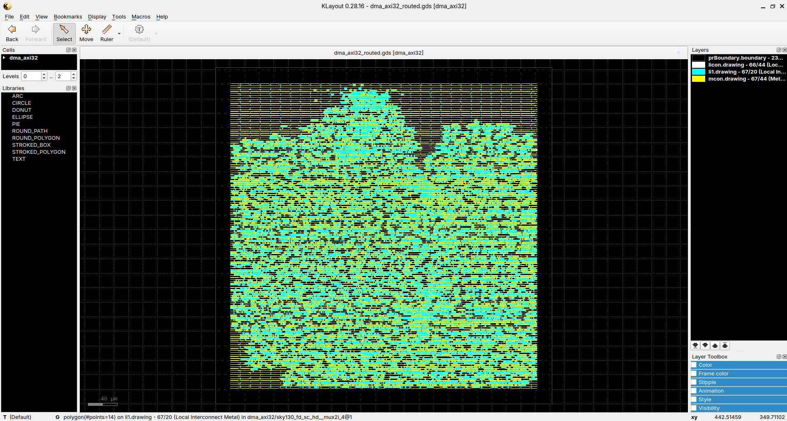
* **Physics & Function:** Shows `licon` (`66/44`) tungsten plugs contacting silicon source/drain terminals, `li1` (`67/20`) titanium local interconnect lines, and `mcon` (`67/44`) plugs elevating connections to Metal 1.

#### 6. Inter-Metal Vias (`vias`): Inter-Layer Elevators
```bash
./scripts/view_layer.sh vias
```
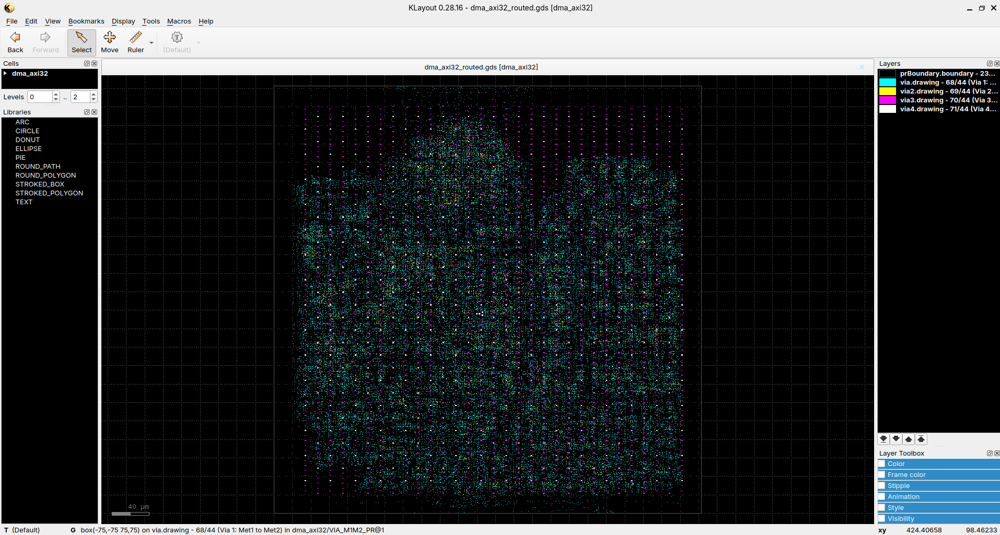
* **Physics & Function:** Shows all 77,456 interlayer vertical vias: `via1` (M1 $\to$ M2, cyan), `via2` (M2 $\to$ M3, yellow), `via3` (M3 $\to$ M4, magenta), and `via4` (M4 $\to$ M5, white). Vias allow orthogonal routing without planar shorts.

---

### Part 3: Back-End of Line (BEOL) — 5-Metal Routing Stack

SkyWater 130nm utilizes an alternating orthogonal routing grid:

#### 7. Metal 1 (`met1`): Standard Cell Power Rails & Local Nets
```bash
./scripts/view_layer.sh met1
```
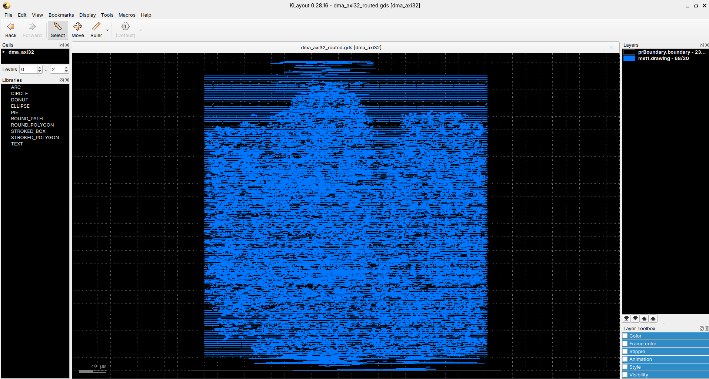
* **Role:** Horizontal routing layer containing standard cell $V_{DD}$ and $V_{SS}$ abutted power rails and local intra-cell signal wires.

#### 8. Metal 2 (`met2`): Vertical Signal Interconnects & I/O Pins
```bash
./scripts/view_layer.sh met2
```
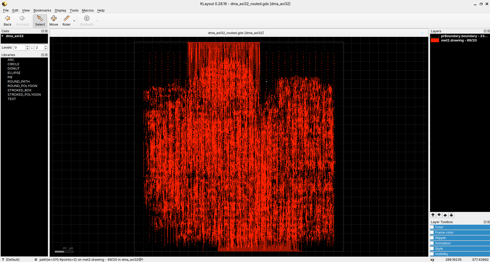
* **Role:** Primary vertical signal routing layer connecting cell pins across horizontal standard cell rows. Also hosts the vertical perimeter I/O pins.

#### 9. Metal 3 (`met3`): Horizontal Long-Distance Bus Routing
```bash
./scripts/view_layer.sh met3
```
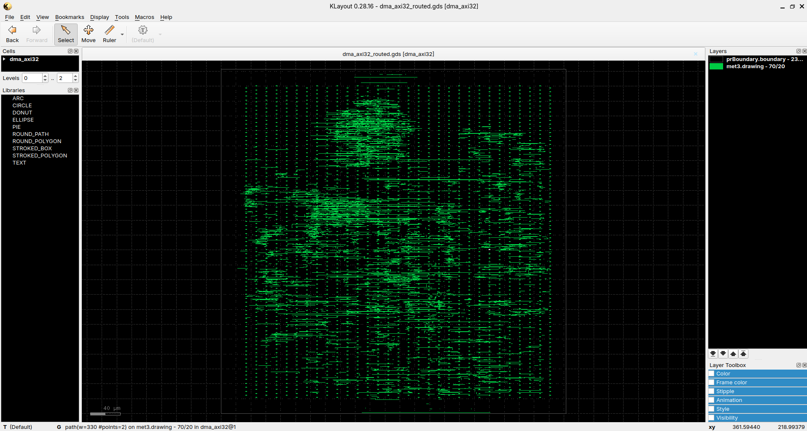
* **Role:** Horizontal interconnect carrying long-distance 32-bit AXI address/data bus signals and horizontal perimeter I/O pins.

#### 10. Metal 4 (`met4`): Upper Horizontal Power Straps
```bash
./scripts/view_layer.sh met4
```
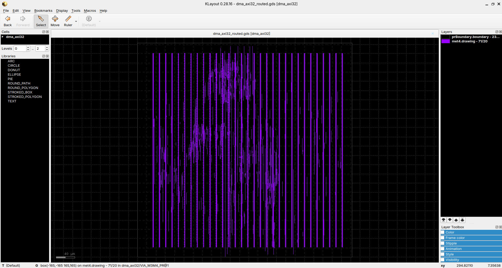
* **Role:** Thick intermediate horizontal metal layer dedicated to low-resistance power distribution straps that prevent IR drop across the chip core.

#### 11. Metal 5 (`met5`): Top Thick Vertical Power Distribution Grid
```bash
./scripts/view_layer.sh met5
```
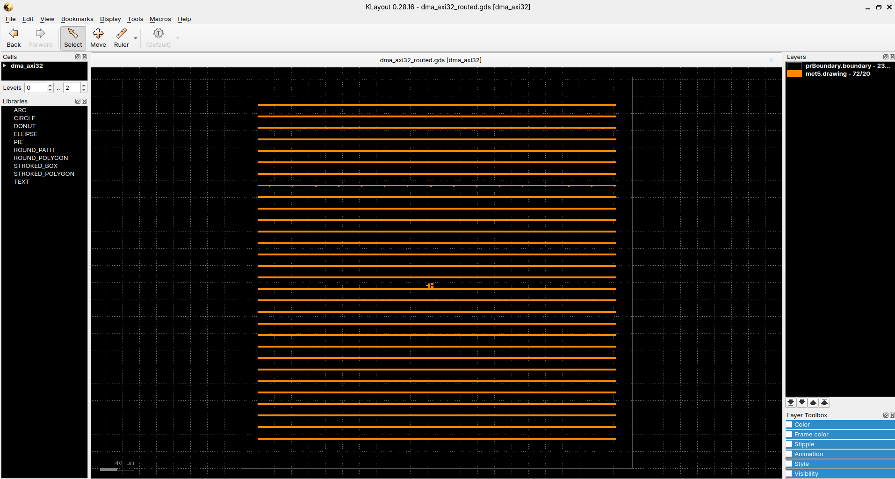
* **Role:** Topmost and thickest metal layer forming the primary vertical power delivery network mesh, feeding power from external pads down into the standard cell array.

---

### Part 4: Combined Silicon Views & Final Production GDSII

#### 12. All 5 Metal Layers Combined (`all`)
```bash
./scripts/view_layer.sh all
```
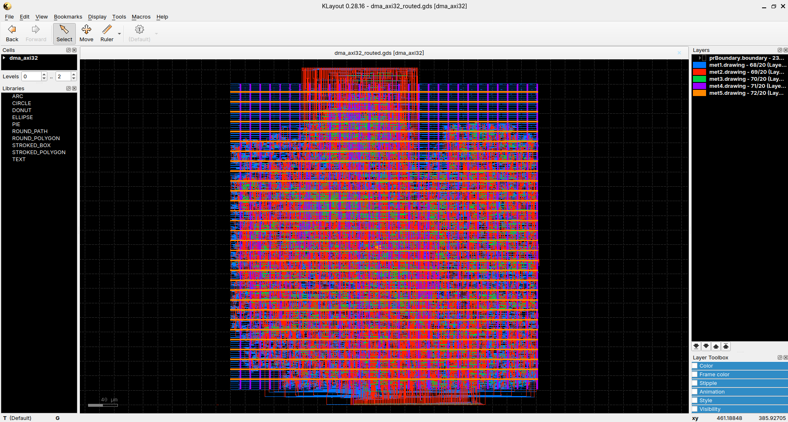
* **Overview:** Displays the complete orthogonal interconnect grid (M1 Blue, M2 Red, M3 Green, M4 Purple, M5 Orange).

#### 13. Complete Routing & Interconnect Stack (`routing`)
```bash
./scripts/view_layer.sh routing
```
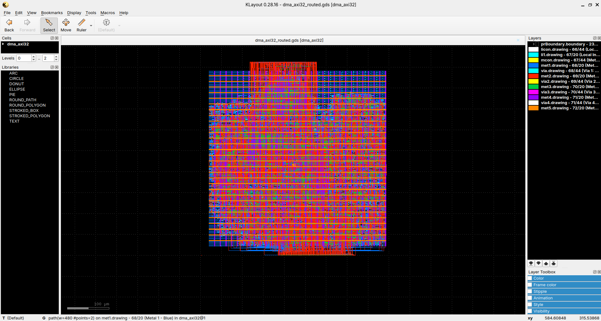
* **Overview:** Shows all 5 metal layers, all inter-metal vias, and contact plugs together in one unified routing view.

#### 14. Full Production Chip GDSII (Master PDK View)
```bash
./scripts/view_gds_klayout.sh
# or
./scripts/view_layer.sh full
```
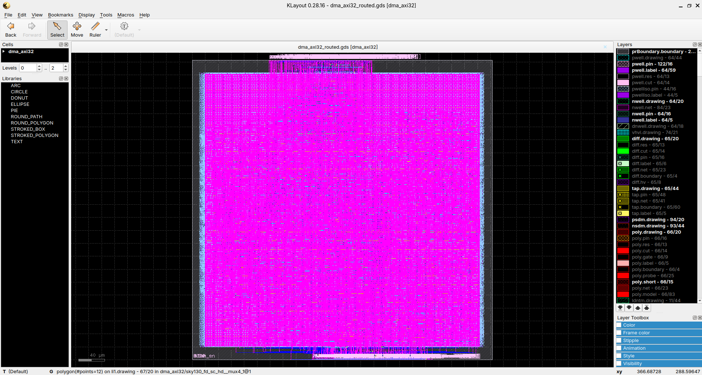
* **Overview:** The tapeout-ready master GDSII stream (`dma_axi32_routed.gds`, 16 MB) rendered with all SkyWater 130A PDK technology layer properties (wells, implants, diffusion, poly, contacts, metals, vias, seal rings, and boundary).

---

## 📁 Repository Directory Structure

```text
dma/
├── README.md                            # Comprehensive Project & Silicon Signoff Guide
├── constraints/
│   └── dma_axi32.sdc                    # SDC Timing Constraints (50 MHz signoff clock)
├── dma_axi/
│   └── src/
│       └── dma_axi32/                   # Provartec PR200 32-bit RTL Verilog Sources (48 modules)
├── docs/
│   ├── PR200_DMA_Physical_Design_Final_Report.md  # Detailed Signoff Report with Timing & Power
│   ├── PR200_SOC_DMA_Architecture_and_Flow.md     # SoC Context & 17-Chapter PD Methodology
│   ├── PR200_DMA_Commands_and_Execution_Guide.md  # Command-line cheat sheet
│   ├── images/                          # High-resolution screenshots of all silicon layers
│   └── reference/
│       └── PR200_trm_rev1.6.pdf         # Official Provartec Hardware Reference Manual
├── pd/
│   ├── cts/                             # Clock Tree Synthesis DEF and reports
│   ├── floorplan/                       # Floorplanned DEF with 377 perimeter pins
│   ├── placement/                       # Placed DEF with welltap continuity
│   ├── reports/                         # Full OpenROAD execution logs and STA timing reports
│   ├── routing/
│   │   ├── dma_axi32_routed.def         # Final Routed DEF (11 MB)
│   │   └── dma_axi32_routed.gds         # Production Tapeout GDSII Stream (16 MB)
│   └── scripts/
│       ├── run_pd_flow.tcl              # Master OpenROAD Physical Design TCL flow script
│       └── run_resume_route.tcl         # Routing standalone resume script
├── scripts/
│   ├── layers/                          # Individual KLayout layer property files (.lyp)
│   ├── run_pd_pr200.sh                  # One-click physical design automation script
│   ├── run_resume_route.sh              # OpenROAD detailed routing execution script
│   ├── run_sim_pr200.sh                 # Icarus Verilog compilation & simulation script
│   ├── run_synth_pr200.sh               # Yosys logic synthesis automation script
│   ├── view_gds_klayout.sh              # Full-chip KLayout GDSII viewer
│   ├── view_layer.sh                    # Layer-by-layer isolated silicon inspector
│   └── view_openroad_gui.sh             # Interactive OpenROAD layout & DEF viewer
├── sim/
│   ├── logs/                            # Compilation and simulation logs
│   └── waveforms/                       # Dumped VCD waveform files (baseline, stress, ultra)
├── synth/
│   └── reports/                         # Yosys gate-level cell count and area reports
└── tb/
    ├── tb_dma_axi32.v                   # Baseline functional burst testbench
    ├── tb_dma_axi32_stress.v            # Random backpressure regression testbench
    └── tb_dma_axi32_ultra_stress.v      # High-density multi-tasking regression testbench
```

---

## 📜 Authors & Acknowledgments

* **Original RTL Architecture & IP Core:** **Eyal Hochberg**, **Provartec Ltd.** ([OpenCores.org](http://www.opencores.org)). Released under the GNU Lesser General Public License (LGPL v2.1).
* **ASIC Implementation & Physical Design:** **Sai Kiran** ([@saikirankvdd](https://github.com/saikirankvdd))
* **Target Foundry:** SkyWater Technology (130nm High-Density CMOS)
* **EDA Toolchain:** OpenROAD Project, Yosys, KLayout, Icarus Verilog, GTKWave, Volare
